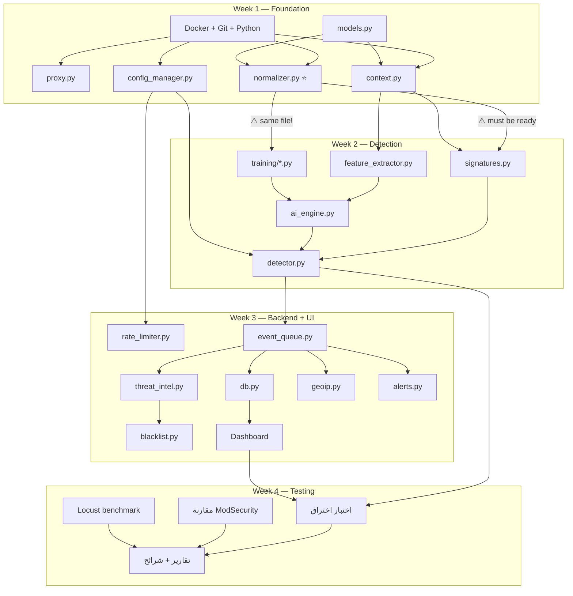

# AI-WAF — الهندسة المعمارية الكاملة

> [!IMPORTANT]
> **مبدأ التصميم الأساسي:** كل أسبوع ينتهي بـ WAF **شغال وقابل للعرض**. مش "شغال في دماغنا" — شغال بـ `docker-compose up` ويحمي Juice Shop. كل أسبوع بيضيف طبقة فوق اللي قبله بدون ما يكسره.

---

## 1. هيكل المشروع الكامل

```
ai-waf/
│
├── docker-compose.yml                    # Week 1 — يشغّل كل حاجة
├── Dockerfile.waf                        # Week 1
├── Dockerfile.dashboard                  # Week 3
├── requirements.txt                      # Week 1 — مثبّت الإصدارات
├── requirements-dashboard.txt            # Week 3
├── requirements-training.txt             # Week 2
├── .env.example                          # Week 1
├── .gitignore                            # Week 1
├── config.yaml                           # Week 1 — الإعدادات الوحيدة
│
├── waf/                                  # ═══ الـ WAF الأساسي ═══
│   ├── __init__.py
│   ├── main.py                           # Week 1 — FastAPI entry + lifecycle
│   ├── proxy.py                          # Week 1 — Reverse proxy + forwarding
│   ├── context.py                        # Week 1 — RequestContext builder
│   ├── normalizer.py                     # Week 1 — ⭐ الملف المشترك مع التدريب
│   ├── config_manager.py                 # Week 1 — YAML loader + hot reload
│   ├── models.py                         # Week 1 — dataclasses (أنواع البيانات)
│   │
│   ├── signatures.py                     # Week 2 — Signature engine
│   ├── ai_engine.py                      # Week 2 — AI prediction wrapper
│   ├── feature_extractor.py              # Week 2 — Structural features
│   ├── detector.py                       # Week 2 — Decision core
│   │
│   ├── rate_limiter.py                   # Week 3 — Token Bucket
│   ├── threat_intel.py                   # Week 3 — AbuseIPDB client
│   ├── blacklist.py                      # Week 3 — Dynamic blacklist
│   ├── geoip.py                          # Week 3 — Country + coordinates
│   ├── event_queue.py                    # Week 3 — Async queue
│   ├── db.py                             # Week 3 — SQLite writer
│   └── alerts.py                         # Week 3 — Alert engine
│
├── dashboard/                            # ═══ الواجهة ═══
│   ├── app.py                            # Week 3 — Streamlit entry
│   ├── pages/
│   │   ├── 1_overview.py                 # Week 3 — عدادات + رسم زمني
│   │   └── 2_alerts.py                   # Week 3 — لوحة التنبيهات
│   └── db_reader.py                      # Week 3 — قراءة SQLite (read-only)
│
├── training/                             # ═══ خط التدريب (أوفلاين) ═══
│   ├── clean_data.py                     # Week 2 — تنظيف + dedup
│   ├── prepare_features.py              # Week 2 — Feature extraction
│   ├── train_lr.py                       # Week 2 — Logistic Regression
│   ├── train_lgbm.py                     # Week 2 — LightGBM (مشروط)
│   ├── evaluate.py                       # Week 2 — تقييم + confusion matrix
│   ├── calibrate.py                      # Week 2 — Calibration
│   └── notebooks/
│       └── training.ipynb                # Week 2 — Colab notebook
│
├── rules/
│   └── rules.json                        # Week 2 — قواعد الـ Signatures
│
├── trained_models/                       # Week 2 — gitignored except hashes
│   ├── vectorizer.pkl
│   ├── model_lr.pkl
│   ├── model_lgbm.pkl                    # مشروط
│   ├── calibrator.pkl
│   └── checksums.sha256
│
├── data/                                 # gitignored بالكامل
│   ├── raw/                              # المصادر الأصلية
│   ├── cleaned/                          # بعد التنظيف
│   ├── splits/                           # train / val / test
│   └── baseline/                         # ترافيك Juice Shop السليم
│
├── tests/
│   ├── conftest.py                       # Week 1 — fixtures مشتركة
│   ├── test_proxy.py                     # Week 1
│   ├── test_normalizer.py               # Week 1
│   ├── test_context.py                   # Week 1
│   ├── test_signatures.py               # Week 2
│   ├── test_detector.py                  # Week 2
│   ├── test_rate_limiter.py              # Week 3
│   ├── test_integration.py              # Week 3
│   └── payloads/
│       ├── sqli.txt                      # Week 2 — payloads اختبار
│       ├── xss.txt
│       ├── traversal.txt
│       ├── cmdi.txt
│       └── benign.txt                    # Week 1
│
├── scripts/
│   ├── generate_baseline.py             # Week 1 — تسجيل ترافيك سليم
│   ├── benchmark.py                      # Week 4 — Locust test
│   └── demo.py                           # Week 4 — سكريبت العرض
│
└── docs/
    ├── architecture.md                   # هذا الملف
    ├── threat_model.md                   # Week 1
    └── decisions.md                      # سجل القرارات
```

---

## 2. أنواع البيانات الأساسية (العقود بين المكونات)

> [!IMPORTANT]
> **هذه هي العقود.** كل عضو في التيم لازم يعرفها. لو مكونين بيتكلموا مع بعض، بيتكلموا عبر هذه الأنواع **فقط**. ده اللي بيخلّي الناس تشتغل بالتوازي بدون ما يعطلوا بعض.

### الملف: `waf/models.py`

```python
"""
أنواع البيانات المشتركة لكل المكونات.
يتكتب يوم 1 ويتثبّت. أي تعديل لازم الكل يعرف بيه.
"""
from __future__ import annotations
from dataclasses import dataclass, field
from enum import Enum
from typing import Literal
import time
import uuid


# ───────────────────── القرارات ─────────────────────

class Action(str, Enum):
    ALLOW   = "allow"
    MONITOR = "monitor"   # يعدي بس يتسجل
    BLOCK   = "block"

class AttackType(str, Enum):
    SQLI       = "sqli"
    XSS        = "xss"
    TRAVERSAL  = "path_traversal"
    CMDI       = "command_injection"
    RATE_LIMIT = "rate_limit"
    BLACKLIST  = "blacklisted_ip"
    UNKNOWN    = "unknown"

class Layer(str, Enum):
    WHITELIST  = "whitelist"
    BLACKLIST  = "blacklist"
    RATE_LIMIT = "rate_limit"
    SIGNATURE  = "signature"
    AI         = "ai"
    NONE       = "none"          # عدّى من كل الطبقات


# ───────────────────── سياق الطلب ─────────────────────

@dataclass
class RequestContext:
    """
    يُبنى مرة واحدة لكل طلب في context.py ويتمرر لكل الطبقات.
    بعد بناؤه، الـ normalizer يملأ الحقول _normalized.
    """
    # === الأصلي (لا يتغير بعد البناء) ===
    request_id: str        = field(default_factory=lambda: uuid.uuid4().hex[:12])
    timestamp: float       = field(default_factory=time.time)
    client_ip: str         = ""
    method: str            = ""
    path: str              = ""
    query_string: str      = ""
    headers: dict          = field(default_factory=dict)
    body_raw: bytes        = b""
    body_fields: dict      = field(default_factory=dict)
    content_type: str      = ""

    # === بعد التطبيع (يملأها normalizer.py) ===
    path_normalized: str         = ""
    query_normalized: str        = ""
    body_fields_normalized: dict = field(default_factory=dict)
    decode_iterations: int       = 0     # عدد مرات فك URL

    # === ملف ثابت؟ (يحدده detector.py) ===
    is_static: bool = False


# ───────────────────── نتيجة الفحص ─────────────────────

@dataclass
class DetectionResult:
    """
    الناتج النهائي من detector.py.
    يحتوي على كل المعلومات اللازمة للقرار والتسجيل.
    """
    action: Action            = Action.ALLOW
    layer: Layer              = Layer.NONE
    attack_type: AttackType   = AttackType.UNKNOWN
    rule_id: str              = ""
    confidence: float         = 0.0     # 0.0 = سليم تماماً, 1.0 = خبيث تماماً
    reason: str               = ""
    processing_time_ms: float = 0.0


# ───────────────────── الحدث للتخزين ─────────────────────

@dataclass
class WAFEvent:
    """
    يُبنى من RequestContext + DetectionResult ويُرسل للـ event_queue.
    الكاتب في الخلفية يحوّله لصف في SQLite.
    """
    timestamp: float       = 0.0
    request_id: str        = ""
    client_ip: str         = ""
    method: str            = ""
    path: str              = ""
    payload_snippet: str   = ""      # أول 500 حرف، نص عادي فقط
    attack_type: str       = ""
    layer: str             = ""
    rule_id: str           = ""
    confidence: float      = 0.0
    action: str            = ""
    processing_time_ms: float = 0.0
    country: str           = ""
    latitude: float        = 0.0
    longitude: float       = 0.0

    @classmethod
    def from_context_and_result(
        cls,
        ctx: RequestContext,
        result: DetectionResult,
    ) -> "WAFEvent":
        """Factory method — المكان الوحيد اللي بيحوّل Context+Result لـ Event."""
        snippet = (ctx.query_string + " " + str(ctx.body_fields))[:500]
        return cls(
            timestamp=ctx.timestamp,
            request_id=ctx.request_id,
            client_ip=ctx.client_ip,
            method=ctx.method,
            path=ctx.path,
            payload_snippet=snippet,
            attack_type=result.attack_type.value,
            layer=result.layer.value,
            rule_id=result.rule_id,
            confidence=result.confidence,
            action=result.action.value,
            processing_time_ms=result.processing_time_ms,
        )


# ───────────────────── التنبيه ─────────────────────

@dataclass
class Alert:
    """تنبيه يُعرض في الـ Dashboard."""
    id: str                = field(default_factory=lambda: uuid.uuid4().hex[:12])
    created_at: float      = field(default_factory=time.time)
    last_seen: float       = field(default_factory=time.time)
    severity: str          = "info"     # info | medium | high
    attack_type: str       = ""
    client_ip: str         = ""
    path: str              = ""
    payload_snippet: str   = ""
    confidence: float      = 0.0
    count: int             = 1
    status: str            = "new"      # new | acknowledged | resolved
    rule_id: str           = ""
```

---

## 3. مخطط تدفق الطلب (Request Flow)

```
                         ┌─────────────────────────────────────────┐
                         │              CLIENT REQUEST              │
                         └────────────────┬────────────────────────┘
                                          │
                                          ▼
                              ┌───────────────────────┐
                              │    main.py (FastAPI)    │
                              │  POST/GET/PUT/DELETE/*  │
                              └───────────┬───────────┘
                                          │
                    ┌─────────────────────┼─────────────────────┐
                    │           context.py: build()              │
                    │  يقرأ method, path, query, headers, body   │
                    │  يحلل JSON / form-urlencoded              │
                    │  يطلع RequestContext                      │
                    └─────────────────────┬─────────────────────┘
                                          │
                                          ▼
              ┌─────────────────── detector.py: detect() ───────────────────┐
              │                                                             │
              │  ┌─────────────┐    ┌──────────────┐    ┌──────────────┐   │
              │  │ 1. Whitelist │───▶│ 2. Blacklist  │───▶│ 3. Rate Limit│   │
              │  │ (config.yaml)│    │(memory Set)   │    │(Token Bucket)│   │
              │  └──────┬──────┘    └──────┬───────┘    └──────┬───────┘   │
              │    ALLOW │ ▲          BLOCK │               BLOCK│          │
              │    (skip)│ │               │                    │          │
              │         pass              pass                pass         │
              │          │                 │                    │          │
              │          ▼                 ▼                    ▼          │
              │  ┌──────────────┐   ┌──────────────┐                      │
              │  │ 4. is_static? │──▶│ 5. Normalizer │                     │
              │  │  skip deep    │   │ (normalizer.py)│                    │
              │  │  inspection   │   └──────┬───────┘                      │
              │  └──────────────┘          │                               │
              │                            ▼                               │
              │                   ┌──────────────┐                         │
              │                   │ 6. Signatures │  ◄── rules.json        │
              │                   │(signatures.py)│                        │
              │                   └──────┬───────┘                         │
              │                     HIT? │                                 │
              │                    ┌─────┴─────┐                          │
              │                    │YES         │NO                       │
              │                    ▼            ▼                         │
              │               BLOCK         ┌──────────────┐              │
              │            (short-circuit)   │ 7. AI Engine  │             │
              │                             │(ai_engine.py) │             │
              │                             └──────┬───────┘              │
              │                                    │                      │
              │                            confidence score               │
              │                                    │                      │
              │                    ┌───────────────┼───────────────┐      │
              │                    │               │               │      │
              │               < low_th      between thresholds  > high_th │
              │                    │               │               │      │
              │                  ALLOW          MONITOR          BLOCK    │
              │                                                           │
              └────────────────────────┬──────────────────────────────────┘
                                       │
                        ┌──────────────┴──────────────┐
                        │                             │
                   action=BLOCK                 action=ALLOW/MONITOR
                        │                             │
                        ▼                             ▼
                ┌──────────────┐              ┌──────────────┐
                │  Return 403   │              │ proxy.forward │
                │  Forbidden    │              │  → Juice Shop │
                └──────┬───────┘              │  port 3000    │
                       │                      └──────┬───────┘
                       │                             │
                       └──────────┬──────────────────┘
                                  │
                                  ▼
                    ┌────────────────────────────┐
                    │ event_queue.put(WAFEvent)   │ ◄── غير متزامن
                    │ (لا يُبطئ الرد)            │     الرد خلاص راح
                    └────────────────────────────┘
```

---

## 4. مخطط الخلفية (Background Flow)

```
    event_queue (asyncio.Queue)
           │
           ▼
    ┌─────────────────────────────────────────────────┐
    │           Background Writer (كاتب وحيد)          │
    │  يسحب دفعات كل 0.5 ثانية أو كل 50 حدث          │
    │                                                   │
    │  لكل حدث:                                        │
    │  ├── geoip.enrich(event)  → country, lat, lng    │
    │  ├── db.insert(event)     → waf_events table      │
    │  ├── alerts.check(event)  → يولّد Alert لو لازم  │
    │  │   └── db.insert_alert(alert)                   │
    │  └── threat_intel.lookup(ip) → AbuseIPDB          │
    │      └── blacklist.maybe_add(ip)                  │
    └─────────────────────────────────────────────────┘
           │
           ▼
    ┌─────────────┐        ┌─────────────────────────┐
    │  SQLite WAL  │◄───────│  Dashboard (read-only)   │
    │ waf_events.db│        │  كل 1-2 ثانية           │
    └─────────────┘        └─────────────────────────┘
```

---

## 5. مخطط التدريب (Training Flow — أوفلاين)

```
    ┌──────────────────────────────────────────────────────┐
    │                    مصادر البيانات                      │
    │  SR-BH (907K) + Juice Shop baseline + sqlmap payloads │
    └────────────────────────┬─────────────────────────────┘
                             │
                             ▼
                    ┌─────────────────┐
                    │  clean_data.py   │
                    │  1. hash dedup    │
                    │  2. sig scan      │
                    │  3. remove headers│
                    │  4. normalize ◄───┼── يستخدم نفس normalizer.py!
                    └────────┬────────┘
                             │
                             ▼
                    ┌─────────────────┐
                    │ prepare_features │
                    │  TF-IDF vectorize│
                    │  structural feat.│
                    └────────┬────────┘
                             │
               ┌─────────────┼─────────────────┐
               ▼             ▼                  ▼
        ┌────────────┐ ┌──────────────┐  ┌────────────┐
        │  train_lr   │ │  train_lgbm   │  │ calibrate   │
        │  (أساسي)    │ │  (مشروط)     │  │ (بعد LR)    │
        └─────┬──────┘ └──────┬───────┘  └──────┬─────┘
              │               │                 │
              ▼               ▼                 ▼
        ┌─────────────────────────────────────────┐
        │           trained_models/                 │
        │  vectorizer.pkl + model_lr.pkl            │
        │  + calibrator.pkl + checksums.sha256      │
        │  (+model_lgbm.pkl لو اتعمل)              │
        └─────────────────────────────────────────┘
```

---

## 6. تفصيل الأسبوع الأول: Foundation (12–19 أكتوبر)

> **الهدف:** WAF بيشتغل كـ Reverse Proxy شفاف + Normalizer + تسجيل ترافيك

### 6.1 Docker Compose

```yaml
# docker-compose.yml
version: "3.9"

networks:
  waf-internal:        # Juice Shop هنا بس — مش متاح من بره
    internal: true
  waf-external:        # الـ WAF والـ Dashboard
    internal: false

services:
  juiceshop:
    image: bkimminich/juice-shop:latest
    networks:
      - waf-internal
    # ⚠️ لا يوجد ports: — مش متاح من بره!
    restart: unless-stopped
    mem_limit: 512m

  waf:
    build:
      context: .
      dockerfile: Dockerfile.waf
    ports:
      - "8080:8080"
    networks:
      - waf-internal     # عشان يوصل لـ Juice Shop
      - waf-external     # عشان العميل يوصلله
    volumes:
      - ./config.yaml:/app/config.yaml:ro
      - ./rules:/app/rules:ro
      - ./trained_models:/app/trained_models:ro
      - ./data/waf_data:/app/data      # SQLite + logs
    env_file: .env
    depends_on:
      - juiceshop
    restart: unless-stopped
    mem_limit: 1g

  dashboard:
    build:
      context: .
      dockerfile: Dockerfile.dashboard
    ports:
      - "8501:8501"
    networks:
      - waf-external
    volumes:
      - ./data/waf_data:/app/data:ro   # قراءة فقط!
    restart: unless-stopped
    mem_limit: 512m
    profiles: ["full"]     # في الأسبوع 1 مش محتاجينه
```

### 6.2 الـ Dockerfiles

```dockerfile
# Dockerfile.waf
FROM python:3.11-slim
WORKDIR /app
COPY requirements.txt .
RUN pip install --no-cache-dir -r requirements.txt
COPY waf/ ./waf/
COPY rules/ ./rules/
COPY trained_models/ ./trained_models/
CMD ["uvicorn", "waf.main:app", "--host", "0.0.0.0", "--port", "8080", \
     "--log-level", "warning", "--no-access-log"]
```

```dockerfile
# Dockerfile.dashboard
FROM python:3.11-slim
WORKDIR /app
COPY requirements-dashboard.txt .
RUN pip install --no-cache-dir -r requirements-dashboard.txt
COPY dashboard/ ./dashboard/
CMD ["streamlit", "run", "dashboard/app.py", "--server.port=8501", \
     "--server.address=0.0.0.0"]
```

### 6.3 واجهات المكونات (Function Signatures)

#### `waf/main.py` — نقطة الدخول

```python
"""
FastAPI application — catch-all route.
Week 1: proxy فقط (بدون فحص)
Week 2+: يضيف detector
"""
from fastapi import FastAPI, Request, Response
from contextlib import asynccontextmanager

app = FastAPI()

@asynccontextmanager
async def lifespan(app: FastAPI):
    """
    عند التشغيل:
    - يحمّل الإعدادات (config_manager.load)
    - يبني httpx client (proxy.init_client)
    - Week 2: يحمّل الموديلات (ai_engine.load_models)
    - Week 3: يبدأ event_queue + background writer
    - يعمل warm-up
    عند الإيقاف:
    - يقفل httpx client
    - Week 3: يفرّغ الـ queue ويقفل SQLite
    """
    yield

@app.api_route("/{path:path}", methods=["GET","POST","PUT","DELETE","PATCH","OPTIONS","HEAD"])
async def catch_all(request: Request, path: str) -> Response:
    """
    المسار الوحيد — يمسك كل الطلبات.
    
    Week 1: build context → forward → return response
    Week 2: build context → detect → block/forward → return
    Week 3: build context → detect → block/forward → queue event → return
    """
    pass
```

#### `waf/context.py` — بناء سياق الطلب

```python
"""
يبني RequestContext من الطلب الخام.
مسؤولية واحدة: قراءة الطلب وتفكيك أجزاؤه.
"""
from .models import RequestContext

MAX_BODY_SIZE = 1_048_576   # 1 MB

async def build_context(request: Request) -> RequestContext:
    """
    يقرأ:
    - client_ip من request.client.host
    - method, path, query_string
    - headers (نسخة dict)
    - body_raw (مع حد MAX_BODY_SIZE)
    - body_fields: 
        لو Content-Type = application/json → json.loads
        لو Content-Type = application/x-www-form-urlencoded → parse_qs
        غير كده → فاضي
    
    يرجّع RequestContext مملوء بالحقول الأصلية.
    الحقول _normalized تفضل فاضية (الـ normalizer يملأها).
    
    ⚠️ لو الـ body أكبر من الحد → يقطع ويسجل تحذير
    ⚠️ لو الـ JSON مش valid → يعامل الـ body كنص واحد
    """
    pass
```

#### `waf/normalizer.py` — ⭐ الملف الأهم

```python
"""
⚠️⚠️⚠️ هذا الملف يُستخدم في مكانين:
    1. داخل الـ WAF أثناء التشغيل (inference)
    2. في خط التدريب (training/clean_data.py)
    
    أي تغيير هنا لازم يتبعه إعادة تدريب الموديلات.
    لو الموديل اتدرب على normalizer قديم والـ WAF بيشتغل بجديد = كارثة.
⚠️⚠️⚠️

الدوال العامة (public API):
    normalize_text(text: str) -> NormalizedResult
    normalize_context(ctx: RequestContext) -> RequestContext
"""
from dataclasses import dataclass

MAX_DECODE_ITERATIONS = 5

@dataclass
class NormalizedResult:
    original: str
    normalized: str
    decode_iterations: int


def normalize_text(text: str) -> NormalizedResult:
    """
    يطبّق التطبيع على نص واحد:
    
    1. URL decode تكراري (حتى لا يتغير أو MAX_DECODE_ITERATIONS)
    2. HTML entity decode (&lt; → < etc.)
    3. Unicode NFKC normalization
    4. Remove null bytes (\x00) and unusual whitespace
    5. SQL comments /**/ → single space
    6. MySQL conditional comments /*!50000SELECT*/ → extract "SELECT"
    7. Lowercase
    
    يرجّع NormalizedResult فيه الأصل والمطبّع وعدد مرات الفك.
    """
    pass


def normalize_context(ctx: RequestContext) -> RequestContext:
    """
    يطبّع كل أجزاء الـ RequestContext:
    - path → path_normalized
    - query_string → query_normalized  
    - body_fields → body_fields_normalized (كل حقل لوحده)
    - يسجل أعلى decode_iterations
    
    يرجّع نفس الـ ctx بعد ملء الحقول.
    """
    pass
```

#### `waf/proxy.py` — إعادة التوجيه

```python
"""
عميل httpx واحد مع Connection Pooling.
"""
import httpx

# يُبنى مرة في lifespan
_client: httpx.AsyncClient | None = None

BACKEND_URL = "http://juiceshop:3000"    # من Docker network

# Headers اللي ما نمررهاش (Hop-by-Hop)
HOP_BY_HOP = frozenset({
    "connection", "keep-alive", "proxy-authenticate",
    "proxy-authorization", "te", "trailers",
    "transfer-encoding", "upgrade",
})

async def init_client():
    """يبني httpx.AsyncClient مع connection pool."""
    global _client
    _client = httpx.AsyncClient(
        base_url=BACKEND_URL,
        timeout=10.0,
        limits=httpx.Limits(max_connections=50, max_keepalive_connections=20),
    )

async def close_client():
    """يقفل الـ client عند الإيقاف."""
    if _client:
        await _client.aclose()

async def forward(request: Request, ctx: RequestContext) -> Response:
    """
    يبعت الطلب لـ Juice Shop ويرجّع الرد.
    
    - يحذف Hop-by-Hop headers
    - يضيف X-Forwarded-For
    - لو Backend وقع → يرجّع 502
    - ينقل status_code + headers + body من الرد
    
    Returns: FastAPI Response
    """
    pass
```

#### `waf/config_manager.py` — الإعدادات

```python
"""
يحمّل config.yaml ويدعم Hot Reload.
Thread-safe عبر copy-on-write (بيبدّل reference مش بيعدّل في المكان).
"""
from dataclasses import dataclass

@dataclass(frozen=True)    # immutable عشان thread-safe
class WAFConfig:
    # ─── الوضع العام ───
    mode: str = "block"                 # "block" | "monitor"
    
    # ─── تشغيل/إيقاف الطبقات ───
    enable_rate_limit: bool = True
    enable_normalizer: bool = True
    enable_signatures: bool = True
    enable_ai: bool = True
    
    # ─── حدود الـ AI ───
    ai_block_threshold: float = 0.85
    ai_monitor_threshold: float = 0.5
    
    # ─── Signatures ───
    paranoia_level: int = 1              # 1-4
    
    # ─── Rate Limit ───
    rate_limit_requests: int = 60
    rate_limit_window_seconds: int = 60
    rate_limit_login_requests: int = 10
    rate_limit_login_window: int = 60
    
    # ─── Blacklist ───
    blacklist_strike_count: int = 5
    blacklist_strike_window: int = 300    # seconds
    blacklist_ban_duration: int = 3600
    blacklist_abuseipdb_threshold: int = 80
    
    # ─── AbuseIPDB ───
    abuseipdb_cache_hours: int = 24
    
    # ─── Alert ───
    alert_dedup_window: int = 5          # seconds
    
    # ─── تخطي الملفات الثابتة ───
    skip_static: bool = True
    static_extensions: tuple = (".js", ".css", ".png", ".jpg", ".gif",
                                 ".ico", ".svg", ".woff", ".woff2", ".map")
    
    # ─── القائمة البيضاء ───
    whitelist_ips: tuple = ()
    
    # ─── Demo mode ───
    demo_mode: bool = False
    demo_trusted_ip: str = ""


# الـ Config الحالي (global, يتبدّل atomically)
_current: WAFConfig = WAFConfig()

def load(path: str = "config.yaml") -> WAFConfig:
    """يحمّل من YAML ويبدّل _current."""
    pass

def get() -> WAFConfig:
    """يرجّع الـ Config الحالي (immutable copy)."""
    return _current

def reload():
    """Hot reload — يتنادى من signal أو endpoint."""
    pass
```

---

## 7. تفصيل الأسبوع التاني: Detection Engine (20–26 أكتوبر)

> **الهدف:** الـ WAF بيمسك هجمات بالـ Signatures والـ AI

### 7.1 واجهات المكونات

#### `waf/signatures.py`

```python
"""
محرك قواعد الـ Signatures.
كل فئة هجوم = regex واحد مترجم مسبقاً (compiled).
"""
import re
from dataclasses import dataclass
from .models import RequestContext, AttackType

@dataclass
class SignatureHit:
    rule_id: str
    attack_type: AttackType
    matched_field: str      # "path" | "query" | "body.fieldname"
    matched_pattern: str    # اسم القاعدة (مش الـ regex!)
    paranoia_level: int

# يتحمّل مرة عند التشغيل
_compiled_rules: list = []

def load_rules(path: str = "rules/rules.json"):
    """
    يقرأ rules.json ويترجم كل regex مسبقاً.
    
    ⚠️ يتأكد من:
    - مفيش nested quantifiers (حماية من ReDoS)
    - كل regex بيترجم بنجاح
    - يرفض أي قاعدة فاشلة ويسجل تحذير بدل ما يقع
    """
    pass

def scan(ctx: RequestContext, paranoia_level: int = 1) -> SignatureHit | None:
    """
    يفحص path_normalized + query_normalized + body_fields_normalized
    بالقواعد اللي paranoia_level ≤ المطلوب.
    
    أول hit = يرجع فوراً (short-circuit).
    لو مفيش hit = يرجع None.
    
    ⚠️ يفحص النسخة المطبّعة أولاً. لو مفيش hit، يفحص الأصلية كمان.
    (عشان لو التطبيع غيّر المعنى، نمسك الهجوم في الأصل)
    """
    pass
```

#### `rules/rules.json` — شكل القواعد

```json
{
  "version": "1.0",
  "rules": [
    {
      "id": "sqli-001",
      "category": "sqli",
      "name": "Basic SQL Injection - OR/AND with always-true",
      "pattern": "(?:'|\")?\\s*(?:OR|AND)\\s+['\"]?\\d+['\"]?\\s*=\\s*['\"]?\\d+",
      "severity": "high",
      "paranoia_level": 1,
      "targets": ["query", "body"],
      "enabled": true
    },
    {
      "id": "sqli-002",
      "category": "sqli",
      "name": "SQL Keywords after quote",
      "pattern": "(?:'|\")?\\s*;?\\s*(?:SELECT|INSERT|UPDATE|DELETE|DROP|UNION|ALTER)\\b",
      "severity": "high",
      "paranoia_level": 1,
      "targets": ["query", "body"],
      "enabled": true
    },
    {
      "id": "xss-001",
      "category": "xss",
      "name": "Script tag injection",
      "pattern": "<\\s*script[^>]*>",
      "severity": "high",
      "paranoia_level": 1,
      "targets": ["query", "body", "path"],
      "enabled": true
    }
  ]
}
```

#### `waf/feature_extractor.py`

```python
"""
يستخرج Features هيكلية من RequestContext.
نفس الـ Features تُستخدم في التدريب والتشغيل.
"""
from .models import RequestContext
import numpy as np

FEATURE_NAMES = [
    "total_length",           # طول النص الكامل
    "special_char_count",     # عدد الرموز الخاصة ('";|<>&)
    "special_char_ratio",     # نسبة الرموز للطول
    "entropy",                # Shannon entropy
    "decode_iterations",      # عدد مرات فك URL
    "sql_keyword_count",      # عدد كلمات SQL (SELECT, UNION, etc.)
    "path_depth",             # عدد / في المسار
    "unique_char_count",      # عدد الحروف الفريدة
    "max_param_length",       # أطول قيمة parameter
    "uppercase_ratio",        # نسبة الحروف الكبيرة (قبل التطبيع)
    "has_encoding",           # هل فيه % أو \x في الأصل
    "non_printable_count",    # عدد الحروف غير المطبوعة
]

def extract(ctx: RequestContext) -> np.ndarray:
    """
    يرجّع array بحجم len(FEATURE_NAMES).
    يشتغل على النسخة المطبّعة + بعض الحقول الأصلية.
    """
    pass

def extract_text_for_tfidf(ctx: RequestContext) -> str:
    """
    يرجّع النص الموحد اللي يدخل الـ TF-IDF vectorizer:
    path_normalized + " " + query_normalized + " " + values(body_fields_normalized)
    """
    pass
```

#### `waf/ai_engine.py`

```python
"""
يحمّل الموديلات ويعمل prediction.
"""
import joblib
import hashlib
from pathlib import Path
from .models import RequestContext
from .feature_extractor import extract, extract_text_for_tfidf

# يتحمّلوا مرة في lifespan
_vectorizer = None
_model_lr = None
_calibrator = None
_model_lgbm = None         # None لو مش موجود

MODELS_DIR = Path("trained_models")

def load_models():
    """
    يحمّل الموديلات ويتأكد من الـ checksums.
    
    ⚠️ لو ملف مش موجود أو الـ hash غلط:
    - LR: يقع (أساسي، مينفعش بدونه)
    - LightGBM: يتجاهل ويكمل بـ LR فقط
    - يسجل تحذير واضح
    """
    pass

def verify_checksum(filepath: Path) -> bool:
    """يقارن SHA256 بـ checksums.sha256."""
    pass

def predict(ctx: RequestContext) -> float:
    """
    يرجّع confidence score واحد بين 0.0 و 1.0.
    
    الخطوات:
    1. text = extract_text_for_tfidf(ctx)
    2. tfidf_vector = _vectorizer.transform([text])
    3. lr_proba = _model_lr.predict_proba(tfidf_vector)[0][1]
    4. calibrated = _calibrator.predict_proba(...)[0][1]
    
    5. لو LightGBM موجود:
       features = extract(ctx)
       lgbm_proba = _model_lgbm.predict_proba([features])[0][1]
       final = 0.5 * calibrated + 0.5 * lgbm_proba    # أبسط ensemble
    6. لو مش موجود:
       final = calibrated
    
    7. return final
    """
    pass

def warmup():
    """يبعت طلب تجريبي عشان أول inference يبقى سريع."""
    pass
```

#### `waf/detector.py` — القلب

```python
"""
Decision Core — يدمج كل الطبقات ويطلّع القرار النهائي.
هذا الملف هو المنسق. مش بيعمل شغل بنفسه — بينادي الطبقات بالترتيب.
"""
import time
from .models import RequestContext, DetectionResult, Action, Layer, AttackType
from . import config_manager, normalizer, signatures, ai_engine

# ملفات ثابتة معروفة
STATIC_EXTENSIONS = None   # تتحمّل من config

# LRU Cache للمدخلات المتكررة
from functools import lru_cache

@lru_cache(maxsize=2048)
def _cached_ai_predict(text_hash: str, features_hash: str) -> float:
    """Cache بـ hash المدخلات بدل المدخلات نفسها."""
    pass   # في الواقع مش هنعمل كده — شوف التعليق تحت

# ⚠️ الـ LRU Cache الحقيقي:
# نعمل cache على (normalized_text_hash) → confidence
# عشان نفس الـ payload المتكرر ما يتحسبش مرتين


async def detect(ctx: RequestContext) -> DetectionResult:
    """
    الدالة الرئيسية. تتنادى من main.py لكل طلب.
    
    الترتيب ثابت ومفيش طبقة بتتخطى إلا بإعداد:
    
    1. Whitelist → ALLOW (skip all)
    2. Blacklist → BLOCK
    3. Rate Limit → BLOCK
    4. Static file? → ALLOW (skip deep inspection)
    5. Normalize
    6. Signatures → BLOCK on hit (short-circuit)
    7. AI → confidence → ALLOW / MONITOR / BLOCK
    8. Default → ALLOW
    
    كل طبقة ممكن تترجع DetectionResult مباشرة (short-circuit).
    
    ⏱️ يحسب processing_time_ms من أول الدالة لآخرها.
    """
    start = time.perf_counter()
    cfg = config_manager.get()
    
    # ... الطبقات بالترتيب ...
    
    result.processing_time_ms = (time.perf_counter() - start) * 1000
    return result
```

### 7.2 مخطط التدريب

```
 ┌─────────────────────────────────────────────────────────────┐
 │                    يوم 7: تنظيف البيانات                      │
 │                                                               │
 │  SR-BH (raw)                                                  │
 │  ├── 1. sha256 hash dedup → يشيل المكرر                      │
 │  ├── 2. signatures.scan() على الفئة "السليمة"                 │
 │  │   └── اللي طابق → يتحرك لـ "مشبوه" (يتراجع أو يتشال)    │
 │  ├── 3. يشيل الـ headers (Host, Cookie, User-Agent)          │
 │  ├── 4. normalizer.normalize_text() على كل payload           │
 │  └── 5. يخزن في data/cleaned/                                │
 │                                                               │
 │  + Juice Shop baseline (من الأسبوع الأول)                    │
 │  + sqlmap payloads (tamper scripts محددة)                     │
 │  + PayloadsAllTheThings (عينة)                                │
 │                                                               │
 │  = data/cleaned/all_data.csv                                  │
 │    columns: [text_normalized, label, source, attack_type]     │
 └──────────────────────────┬──────────────────────────────────┘
                            │
                            ▼
 ┌─────────────────────────────────────────────────────────────┐
 │                    التقسيم (مرة واحدة)                        │
 │                                                               │
 │  stratified split by (label, source):                         │
 │  ├── train:  70%                                              │
 │  ├── val:    15%  ← لاختيار الحدود والـ calibration           │
 │  └── test:   15%  ← لا يُلمس حتى القياس النهائي             │
 │                                                               │
 │  ⚠️ الطلبات من نفس الـ IP أو الجلسة في مجموعة واحدة        │
 │  ⚠️ tamper scripts معينة محجوزة للـ test فقط                  │
 │                                                               │
 │  = data/splits/train.csv, val.csv, test.csv                   │
 └──────────────────────────┬──────────────────────────────────┘
                            │
                            ▼
 ┌─────────────────────────────────────────────────────────────┐
 │               يوم 10: التدريب والتقييم                        │
 │                                                               │
 │  train_lr.py:                                                 │
 │  ├── TF-IDF: char n-grams (2,5), max_features=200000         │
 │  │   sublinear_tf=True                                        │
 │  ├── LogisticRegression(C=1.0, max_iter=1000, random_state=42)│
 │  ├── fit on train                                             │
 │  ├── CalibratedClassifierCV on val (method='isotonic')        │
 │  ├── save: vectorizer.pkl, model_lr.pkl, calibrator.pkl       │
 │  └── sha256 checksums → checksums.sha256                      │
 │                                                               │
 │  evaluate.py:                                                 │
 │  ├── classification_report(target_names=[...])                │
 │  ├── confusion_matrix                                         │
 │  ├── Macro F1, Recall per class                               │
 │  ├── calibration curve (reliability diagram)                  │
 │  └── → docs/model_evaluation.md                               │
 │                                                               │
 │  (مشروط) train_lgbm.py:                                      │
 │  ├── LGBMClassifier on structural features                    │
 │  ├── hyperparameters: n_estimators=300, max_depth=6           │
 │  ├── fit on train                                             │
 │  └── save: model_lgbm.pkl                                     │
 └─────────────────────────────────────────────────────────────┘
```

---

## 8. تفصيل الأسبوع التالت: Backend + Dashboard (27 أكتوبر – 2 نوفمبر)

> **الهدف:** دورة كاملة: هجوم → حجب → تنبيه في الـ Dashboard

### 8.1 واجهات المكونات

#### `waf/rate_limiter.py`

```python
"""
Token Bucket في الذاكرة.
~40 سطر كود. بسيط عن قصد.
"""
from dataclasses import dataclass
import time

@dataclass
class Bucket:
    tokens: float
    last_refill: float

# {ip: Bucket}
_buckets: dict[str, Bucket] = {}

def check(ip: str, is_login: bool = False) -> bool:
    """
    True = مسموح, False = محدود.
    
    - ياخد الحدود من config_manager.get()
    - لو الـ IP مش موجود → ينشئ Bucket جديد
    - يحسب الـ tokens المتجددة
    - لو tokens ≥ 1 → ياخد token ويرجع True
    - لو tokens < 1 → يرجع False
    """
    pass

def cleanup():
    """يشيل Buckets اللي ما اتلمستش من أكتر من 10 دقايق. يتنادى كل دقيقة."""
    pass
```

#### `waf/event_queue.py`

```python
"""
طابور أحداث غير متزامن بين مسار الطلب والكاتب.
"""
import asyncio
from .models import WAFEvent

_queue: asyncio.Queue[WAFEvent] = asyncio.Queue(maxsize=10_000)

async def put(event: WAFEvent):
    """
    يحط الحدث في الطابور.
    لو الطابور ممتلئ → يشيل الأقدم ويحط الجديد (يسجل تحذير).
    ⚠️ لا يُنتظر — يرجع فوراً.
    """
    pass

async def background_writer():
    """
    يشتغل كـ asyncio.Task في الخلفية.
    
    loop forever:
      1. يسحب دفعة (حتى 50 حدث أو كل 0.5 ثانية)
      2. geoip.enrich(events)
      3. db.insert_batch(events)
      4. لكل حدث blocked: alerts.process(event)
      5. لكل IP جديد: threat_intel.lookup(ip)
    """
    pass
```

#### `waf/db.py` — SQLite

```python
"""
كاتب SQLite واحد. لا يُستخدم إلا من background_writer.
الـ Dashboard يقرأ بـ connection منفصل (read-only).
"""
import sqlite3
from pathlib import Path

DB_PATH = Path("data/waf_events.db")

def init_db():
    """
    ينشئ الجداول والفهارس لو مش موجودة.
    يفعّل WAL mode.
    يتنادى مرة في lifespan.
    """
    pass

def insert_batch(events: list["WAFEvent"]):
    """يكتب دفعة أحداث في transaction واحد."""
    pass

def insert_alert(alert: "Alert"):
    """يكتب أو يحدّث تنبيه."""
    pass

def update_alert_status(alert_id: str, status: str):
    """يغيّر حالة التنبيه (acknowledged / resolved)."""
    pass
```

### 8.2 مخطط قاعدة البيانات

```sql
-- ═══════════════════════════════════════════════════
-- يتنفذ مرة واحدة في db.init_db()
-- ═══════════════════════════════════════════════════

PRAGMA journal_mode = WAL;           -- قراءة أثناء الكتابة
PRAGMA busy_timeout = 5000;          -- ينتظر 5 ثواني لو مقفول

-- ─────────── جدول الأحداث ───────────
CREATE TABLE IF NOT EXISTS waf_events (
    id              INTEGER PRIMARY KEY AUTOINCREMENT,
    timestamp       REAL    NOT NULL,
    request_id      TEXT    NOT NULL,
    client_ip       TEXT    NOT NULL,
    method          TEXT    NOT NULL,
    path            TEXT    NOT NULL,
    payload_snippet TEXT    DEFAULT '',     -- أول 500 حرف، نص عادي
    attack_type     TEXT    DEFAULT '',
    layer           TEXT    NOT NULL,       -- whitelist|blacklist|rate_limit|signature|ai|none
    rule_id         TEXT    DEFAULT '',
    confidence      REAL    DEFAULT 0.0,
    action          TEXT    NOT NULL,       -- allow|monitor|block
    processing_time_ms REAL DEFAULT 0.0,
    country         TEXT    DEFAULT '',
    latitude        REAL    DEFAULT 0.0,
    longitude       REAL    DEFAULT 0.0
);

CREATE INDEX IF NOT EXISTS idx_events_timestamp ON waf_events(timestamp);
CREATE INDEX IF NOT EXISTS idx_events_ip        ON waf_events(client_ip);
CREATE INDEX IF NOT EXISTS idx_events_action    ON waf_events(action);
CREATE INDEX IF NOT EXISTS idx_events_attack    ON waf_events(attack_type);

-- ─────────── جدول التنبيهات ───────────
CREATE TABLE IF NOT EXISTS alerts (
    id              TEXT    PRIMARY KEY,
    created_at      REAL    NOT NULL,
    last_seen       REAL    NOT NULL,
    severity        TEXT    NOT NULL,       -- info|medium|high
    attack_type     TEXT    DEFAULT '',
    client_ip       TEXT    DEFAULT '',
    path            TEXT    DEFAULT '',
    payload_snippet TEXT    DEFAULT '',
    confidence      REAL    DEFAULT 0.0,
    count           INTEGER DEFAULT 1,
    status          TEXT    DEFAULT 'new',  -- new|acknowledged|resolved
    rule_id         TEXT    DEFAULT ''
);

CREATE INDEX IF NOT EXISTS idx_alerts_status   ON alerts(status);
CREATE INDEX IF NOT EXISTS idx_alerts_severity ON alerts(severity);
CREATE INDEX IF NOT EXISTS idx_alerts_created  ON alerts(created_at);

-- ─────────── جدول الـ Blacklist ───────────
CREATE TABLE IF NOT EXISTS blacklist (
    ip              TEXT    PRIMARY KEY,
    added_at        REAL    NOT NULL,
    expires_at      REAL    NOT NULL,
    reason          TEXT    DEFAULT '',
    strike_count    INTEGER DEFAULT 0
);

CREATE INDEX IF NOT EXISTS idx_blacklist_expires ON blacklist(expires_at);

-- ─────────── Cache الـ AbuseIPDB ───────────
CREATE TABLE IF NOT EXISTS abuseipdb_cache (
    ip              TEXT    PRIMARY KEY,
    abuse_score     INTEGER DEFAULT 0,
    checked_at      REAL    NOT NULL,
    raw_response    TEXT    DEFAULT ''
);
```

### 8.3 الـ Dashboard — هيكل الصفحات

```python
# dashboard/app.py
"""
Entry point — يعرض عدادات عامة.
"""
import streamlit as st

st.set_page_config(page_title="AI-WAF Dashboard", layout="wide")
st.title("🛡️ AI-WAF Dashboard")

# ─── العدادات ───
# total_requests | blocked | allowed | block_rate%
# st.columns(4) with st.metric()

# ─── رسم زمني ───
# plotly line chart: requests over time, colored by action

# ─── أنواع الهجمات ───
# plotly pie/bar chart: attack_type distribution

# ─── أكتر IPs ───
# st.dataframe: top 10 blocked IPs

# ─── جدول أحداث ───
# st.dataframe with filters (action, attack_type, IP, time range)

# كل ده يتحدث بـ:
# @st.fragment(run_every=timedelta(seconds=2))
```

```python
# dashboard/pages/2_alerts.py
"""
لوحة التنبيهات.
"""
# ─── عداد "جديد" بألوان ───
# High=أحمر, Medium=برتقالي, Info=أزرق

# ─── قائمة التنبيهات ───
# من الأحدث، مع الخطورة واللون

# ─── زر "تم الاطلاع" ───
# يغيّر status في SQLite

# ─── Toast notification ───
# st.toast("🚨 New HIGH alert!") لما يظهر جديد
```

```python
# dashboard/db_reader.py
"""
قراءة SQLite — read-only connection.
كل query هنا — الـ Dashboard مبيكتبش أبداً (إلا update_alert_status).
"""

def get_event_counts(since: float) -> dict:
    """total, blocked, allowed, monitor"""
    pass

def get_events_timeline(since: float, bucket_seconds: int = 60) -> list:
    """events grouped by time bucket and action"""
    pass

def get_attack_distribution(since: float) -> list:
    """count per attack_type"""
    pass

def get_top_ips(since: float, limit: int = 10) -> list:
    """top blocked IPs"""
    pass

def get_recent_events(since: float, limit: int = 100,
                      action: str = None, attack_type: str = None) -> list:
    """filtered events for the table"""
    pass

def get_alerts(status: str = None, severity: str = None) -> list:
    """alerts with filters"""
    pass

def get_new_alert_counts() -> dict:
    """count of new alerts per severity"""
    pass
```

---

## 9. تفصيل الأسبوع الرابع: Testing & Delivery (3–10 نوفمبر)

> **الهدف:** إثبات إن الـ WAF شغال بأرقام، وتسليم

### 9.1 المقارنة المبسطة (4 تكوينات بدل 7)

```
S0: Juice Shop مباشرة (بدون حماية)          → Latency baseline
S1: ModSecurity + CRS                        → خط مقارنة تقليدي
S2: WAF بـ Normalizer + Signatures (بدون AI) → الأساس بدون ذكاء
S4: WAF كامل (Signatures + AI)              → المنتج النهائي
```

| المقياس | يتقاس إزاي |
|---|---|
| Detection Rate (Recall) | `test.csv` (الهجمات المشوهة المحجوزة) |
| FPR | `baseline_benign.csv` (ترافيك Juice Shop السليم) |
| Macro F1 | scikit-learn `classification_report` |
| Latency p50/p95/p99 | Locust على جهاز **تاني** |

### 9.2 سكريبت العرض

```
scripts/demo.py:
1. يشغّل docker-compose up
2. يفتح المتصفح على Dashboard (8501)
3. يبعت طلبات سليمة (5 ثواني) → Dashboard يعرض allow
4. يبعت SQLi عادي → 403 + alert
5. يبعت SQLi مشوه (URL encoded مرتين) → 403 + alert
6. يبعت XSS → 403 + alert
7. يبعت طلبات كتير من نفس الـ IP → rate limit
8. يعرض الـ Dashboard (العدادات + التنبيهات)
```

---

## 10. خريطة التبعيات (ما يعطّل إيه)



> [!CAUTION]
> **النقاط الحرجة (⚠️):**
> 1. `normalizer.py` لازم يخلص ويتثبّت **قبل** بداية أي تدريب. لو اتغير بعد التدريب = الموديلات تترمي.
> 2. `models.py` (أنواع البيانات) لازم يتثبّت يوم 1. أي تغيير = كل الفايلات تتعدل.
> 3. `context.py` لازم يخلص قبل الـ Signatures والـ AI — الاتنين بياخدوا `RequestContext`.

---

## 11. الضمانات المعمارية (12 حماية ضد التعطّل)

### ضمان 1: Fail-Open لكل طبقة اختيارية
```python
# في detector.py — كل طبقة ملفوفة في try/except
async def detect(ctx):
    # ...
    if cfg.enable_signatures:
        try:
            hit = signatures.scan(ctx, cfg.paranoia_level)
        except Exception as e:
            logger.error(f"Signatures failed: {e}")
            hit = None     # ← يكمل بدل ما يقع
    # ...
```

> **القاعدة:** لو أي طبقة فحص وقعت، الطلب **يعدي** (fail-open). أحسن من إن الـ WAF كله يقع. المهم الـ Proxy يفضل شغال.

### ضمان 2: كل طبقة ليها مفتاح تشغيل
```yaml
# config.yaml — ممكن تقفل أي حاجة بدون تعديل كود
enable_rate_limit: true
enable_normalizer: true
enable_signatures: true
enable_ai: true
```

> لو الـ AI بطيء أو فيه bug = `enable_ai: false` وكمّلوا بالـ Signatures.

### ضمان 3: Normalizer واحد بين التدريب والتشغيل
```python
# training/clean_data.py
import sys
sys.path.insert(0, "..")       # ← حل بسيط
from waf.normalizer import normalize_text
```

> **مفيش نسخة تانية من التطبيع أبداً.** لو حد كتب normalize في الـ training بطريقة مختلفة = كارثة.

### ضمان 4: الـ Proxy يشتغل حتى لو كل الطبقات واقعة
```python
# main.py — في أسوأ حالة
@app.api_route("/{path:path}", ...)
async def catch_all(request, path):
    ctx = await build_context(request)
    
    try:
        result = await detect(ctx)
    except Exception:
        # كل الطبقات وقعت — نمرر الطلب
        logger.critical("All detection failed, passing through")
        return await proxy.forward(request, ctx)
    
    if result.action == Action.BLOCK:
        return Response(status_code=403, content="Forbidden")
    
    return await proxy.forward(request, ctx)
```

### ضمان 5: الـ Event Queue لا تبطّئ الطلب
```python
# في main.py — بعد إرسال الرد
async def catch_all(...):
    # ... الفحص والرد ...
    
    # ← ده بيحصل بعد ما الرد اتبعت
    event = WAFEvent.from_context_and_result(ctx, result)
    await event_queue.put(event)     # non-blocking
```

### ضمان 6: SQLite كاتب واحد فقط
```
WAF process → event_queue → background_writer → SQLite (write)
Dashboard process → SQLite (read-only)

⚠️ الـ Dashboard مبيكتبش أبداً في waf_events أو alerts.
   الاستثناء الوحيد: update_alert_status (وده من connection تانية).
```

### ضمان 7: الموديلات تتحمّل مرة واحدة
```python
# في lifespan — مش مع كل طلب
async def lifespan(app):
    config_manager.load()
    await proxy.init_client()
    signatures.load_rules()
    ai_engine.load_models()       # ← مرة واحدة
    ai_engine.warmup()            # ← تسخين
    yield
    await proxy.close_client()
```

### ضمان 8: حد لحجم الـ Body
```python
# context.py
body_raw = await request.body()
if len(body_raw) > MAX_BODY_SIZE:    # 1 MB
    body_raw = body_raw[:MAX_BODY_SIZE]
    logger.warning(f"Body truncated: {len(body_raw)} bytes")
```

### ضمان 9: الـ Payload في الـ Dashboard نص عادي
```python
# dashboard — ⚠️ أمني
# ممنوع:
st.markdown(payload, unsafe_allow_html=True)    # ❌ XSS!

# المطلوب:
st.code(payload[:200])                           # ✅ نص عادي
st.text(payload[:200])                           # ✅ نص عادي
```

### ضمان 10: لا Nested Quantifiers في الـ Regex
```python
# signatures.py — عند تحميل القواعد
import re

DANGEROUS_PATTERNS = re.compile(
    r'(\+|\*|\{[0-9,]+\})\s*(\+|\*|\{[0-9,]+\})'   # nested quantifiers
)

def validate_rule(pattern: str) -> bool:
    if DANGEROUS_PATTERNS.search(pattern):
        logger.error(f"ReDoS risk in pattern: {pattern}")
        return False
    try:
        re.compile(pattern, re.IGNORECASE)
        return True
    except re.error:
        return False
```

### ضمان 11: Short-Circuit يمنع العمل الزائد
```python
# detector.py
# لو الـ Signatures مسكت → مش محتاج AI
if hit:
    return DetectionResult(
        action=Action.BLOCK,
        layer=Layer.SIGNATURE,
        attack_type=hit.attack_type,
        rule_id=hit.rule_id,
        confidence=1.0,
        reason=f"Signature hit: {hit.matched_pattern}",
    )

# لو ملف ثابت → مش محتاج أي فحص عميق
if is_static_file(ctx.path):
    return DetectionResult(action=Action.ALLOW, layer=Layer.NONE)
```

### ضمان 12: Docker Network يمنع الوصول المباشر لـ Juice Shop
```yaml
# docker-compose.yml
networks:
  waf-internal:
    internal: true     # ← ده المفتاح. مفيش وصول من بره.

services:
  juiceshop:
    networks:
      - waf-internal   # ← بس هنا. مش في waf-external.
    # ⚠️ لاحظ: مفيش ports: — ده عن قصد
```

---

## 12. `requirements.txt` — الإصدارات مثبتة

```txt
# ═══ WAF Core ═══
fastapi==0.115.12
uvicorn[standard]==0.34.3
httpx==0.28.1
pyyaml==6.0.2

# ═══ AI/ML ═══
scikit-learn==1.6.1
joblib==1.5.1
lightgbm==4.6.0
numpy==2.2.6

# ═══ Threat Intel ═══
geoip2==4.8.1

# ═══ Testing ═══
pytest==8.3.5
pytest-asyncio==0.26.0
```

```txt
# requirements-dashboard.txt
streamlit==1.44.1
plotly==6.1.2

# requirements-training.txt  (Colab / local)
scikit-learn==1.6.1
lightgbm==4.6.0
pandas==2.2.3
matplotlib==3.10.3
```

> [!WARNING]
> **الإصدارات دي توضيحية.** قبل ما تثبّتوها، شغّلوا `pip install` واكتبوا الإصدارات اللي نزلت فعلاً. المهم إن **نفس الرقم** يكون في الـ WAF وفي Colab وعلى كل جهاز.

---

## 13. ملف الإعدادات الكامل

```yaml
# config.yaml — النسخة الافتراضية

# ─── الوضع العام ───
mode: block                # block | monitor

# ─── الطبقات ───
enable_rate_limit: true
enable_normalizer: true
enable_signatures: true
enable_ai: true

# ─── AI ───
ai_block_threshold: 0.85
ai_monitor_threshold: 0.5

# ─── Signatures ───
paranoia_level: 1

# ─── Rate Limit ───
rate_limit:
  requests: 60
  window_seconds: 60
  login_requests: 10
  login_window_seconds: 60
  login_paths:
    - "/rest/user/login"
    - "/api/Users"

# ─── Blacklist ───
blacklist:
  strike_count: 5
  strike_window_seconds: 300
  ban_duration_seconds: 3600
  abuseipdb_threshold: 80

# ─── AbuseIPDB ───
abuseipdb:
  enabled: true
  cache_hours: 24

# ─── Alerts ───
alerts:
  dedup_window_seconds: 5

# ─── Static Files ───
skip_static: true
static_extensions:
  - .js
  - .css
  - .png
  - .jpg
  - .gif
  - .ico
  - .svg
  - .woff
  - .woff2
  - .map

# ─── Whitelist ───
whitelist_ips: []

# ─── Demo ───
demo_mode: false
demo_trusted_ip: ""

# ─── Backend ───
backend_url: "http://juiceshop:3000"
body_max_size: 1048576       # 1 MB
```

---

## 14. قائمة التحقق لكل انتقال بين الأسابيع

### ✅ البوابة أ (نهاية الأسبوع 1 — 19 أكتوبر)

```
□ docker-compose up يشغّل WAF + Juice Shop بدون أخطاء
□ http://localhost:8080 يعرض Juice Shop
□ http://localhost:3000 مش شغال (المنفذ مقفول)
□ كل سيناريوهات الـ Baseline تعطي نفس النتيجة
□ normalizer.py: كل خطوة ليها pytest
□ Baseline Traffic Logs اتسجلت في data/baseline/
□ SR-BH dataset اتحمّل في data/raw/
□ config.yaml يتحمّل بنجاح
□ models.py مستقر ومتفق عليه
```

### ✅ البوابة ب (نهاية الأسبوع 2 — 26 أكتوبر)

```
□ Signatures بتمسك هجمات SQLi و XSS معروفة
□ Signatures مش بتحجب ترافيك الـ Baseline
□ الموديل 1 (LR) متدرب ومقيّم
□ تقرير التقييم فيه Macro F1 و Confusion Matrix
□ detector.py بيدمج Signatures + AI + Short-Circuit
□ أول قياس Latency اتعمل
□ KPIs اتثبتت بناءً على القياس
□ الموديل بيتحمّل من trained_models/ بنجاح
□ checksums.sha256 متطابق
```

### ✅ البوابة ج (نهاية الأسبوع 3 — 2 نوفمبر)

```
□ Rate Limiting شغال (اختبار: 100 طلب سريع → 429)
□ SQLite فيها أحداث
□ الـ Dashboard بيعرض عدادات + جدول أحداث
□ Alert بيظهر في الـ Dashboard بعد حجب هجوم
□ دورة كاملة: هجوم → حجب → alert → Dashboard
□ AbuseIPDB بيستعلم ويعمل cache (لو الـ API key شغال)
□ Blacklist بيضيف IP بعد تكرار الحجب
```

---

## 15. `.env.example`

```env
# انسخ هذا الملف إلى .env واملأ القيم
# ⚠️ .env لا يُرفع على Git أبداً

ABUSEIPDB_API_KEY=your_key_here
```

---

## 16. `.gitignore`

```gitignore
# ─── بيئة ───
.env
__pycache__/
*.pyc
.venv/
venv/

# ─── بيانات ───
data/
*.db
*.db-wal
*.db-shm

# ─── موديلات (الحجم كبير) ───
trained_models/*.pkl
!trained_models/checksums.sha256

# ─── IDE ───
.idea/
.vscode/
*.swp
```

---

## 17. ملخص: إيه المطلوب من كل عضو كل أسبوع

| الأسبوع | عضو أ (Lead) | عضو ب | عضو ج | عضو د | عضو هـ |
|---|---|---|---|---|---|
| **1** | `main.py` + `proxy.py` + `context.py` | `normalizer.py` + اختباراته | Docker + بيئة + `models.py` | `config_manager.py` + تسجيل baseline | مراجعة + اختبارات + تحميل بيانات |
| **2** | `detector.py` + دمج | `signatures.py` + `rules.json` | تنظيف بيانات + تدريب + `ai_engine.py` | `feature_extractor.py` + اختبارات signatures | اختبارات detector + قياس latency |
| **3** | مراجعة + تكامل | `rate_limiter.py` + `event_queue.py` | `threat_intel.py` + `blacklist.py` + `geoip.py` | `db.py` + `alerts.py` | Dashboard (`app.py` + pages) |
| **4** | سكريبت العرض + بروفة | sqlmap + اختبار اختراق | ModSecurity مقارنة + Locust | التقرير التقني + أرقام | الشرائح + README |
