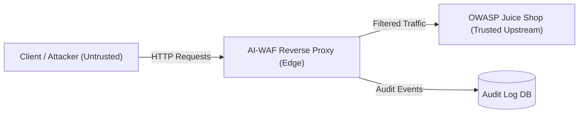

# AI-WAF Threat Model

## 1. System Overview
AI-WAF is an intelligent Web Application Firewall and reverse proxy deployed directly in front of OWASP Juice Shop. It intercepts incoming HTTP traffic to inspect, sanitize, and filter malicious requests before forwarding safe traffic to upstream web services. The WAF combines multi-phase normalization, fast regex signature detection, machine learning anomaly scoring, and dynamic rate limiting.

## 2. Trust Boundaries
- **Untrusted Internet / Client Zone**: External end users, web clients, automated bots, and attackers communicating over HTTP/HTTPS.
- **WAF Inspection Boundary**: Reverse proxy edge terminating requests, extracting RequestContext, performing normalization, evaluating signatures, and querying ML classifiers.
- **Trusted Upstream Zone**: Internal private network connecting AI-WAF to the target application backend (OWASP Juice Shop) and local persistent storage (SQLite audit logs, configuration state).

## 3. Assets
- **Application Data**: Sensitive customer records, credentials, payment tokens, and basket details hosted on OWASP Juice Shop.
- **System Availability**: Uptime and responsiveness of backend web applications and proxy services under heavy or bursty traffic.
- **WAF Configuration & State**: Signature definitions, rate limit thresholds, whitelist/blacklist rules, and API keys.
- **Security Audit Logs**: Historical detection logs, attack event telemetry, and decision audit records.

## 4. Threat Actors
- **Script Kiddies**: Novice attackers utilizing publicly accessible exploits, default scripts, and simple proof-of-concept payloads.
- **Automated Scanners & Bots**: Crawlers and scanners (e.g., Nikto, sqlmap, OWASP ZAP, credential stuffers) probing for generic vulnerabilities.
- **Skilled Attackers**: Targeted adversaries employing multi-layered encoding, obfuscation techniques, ReDoS payloads, and timing-based bypasses.

## 5. Attack Vectors
- **SQL Injection (SQLi)**: Union-based, boolean-based, and error-based attacks targeting database integrity.
- **Cross-Site Scripting (XSS)**: Reflected, stored, and DOM-based script injections targeting client browser execution contexts.
- **Path Traversal & Local File Inclusion (LFI)**: Dot-dot-slash patterns and encoded sequences targeting restricted server filesystem resources.
- **Command Injection (CMDi)**: Shell metacharacter sequences attempting operating system command execution.
- **Rate & Resource Abuse (DoS / Brute Force)**: High-frequency credential stuffing on login endpoints and resource exhaustion attacks.
- **WAF Evasion / Bypass**: Recursive percent-encoding, null byte injection, inline SQL comments, Unicode tricks, and ReDoS triggers.

## 6. Mitigations
| Attack Vector | Detection / Defense Mechanism | Implementation in AI-WAF |
|---|---|---|
| **SQL Injection** | Recursive decoding, comment stripping, AST/regex signatures, and AI scoring | `Normalizer` + `SignatureEngine` (OWASP CRS patterns) + ML vectorizer |
| **Cross-Site Scripting** | HTML entity decoding, script tag / event handler pattern matching | `Normalizer` + `SignatureEngine` (XSS ruleset) |
| **Path Traversal** | Dot-dot-slash normalization, URL decode loops | Regex traversal rule detection on URI paths |
| **Command Injection** | Metacharacter filtering (`;`, `|`, `` ` ``, `$()`) | Regex command patterns on query and request body |
| **Rate Abuse & DoS** | In-memory token bucket rate limiting per client IP | `TokenBucketRateLimiter` with strict login policy |
| **WAF Evasion Techniques** | Canonicalization loop (URL decode, NFKC, null byte strip) | `Normalizer.normalize()` with max iteration guard |
| **ReDoS on WAF Engine** | Regex timeout & rule compilation validation | `validate_rule()` and bounded regular expressions |

## 7. Assumptions
- AI-WAF is deployed as the sole entrypoint into the target backend; direct network access to the backend is blocked via firewall rules.
- Upstream network latency between WAF and backend is negligible (< 2ms).
- Client IP addresses are accurately forwarded via reverse proxy headers or socket level connections.

## 8. Out of Scope
- TLS termination hardware attacks and side-channel cryptographic analysis.
- Layer 3/4 volumetric DDoS mitigation (assumed handled by cloud infrastructure / upstream CDN).
- Server hardware, physical host security, or compromise of operating system root credentials.
